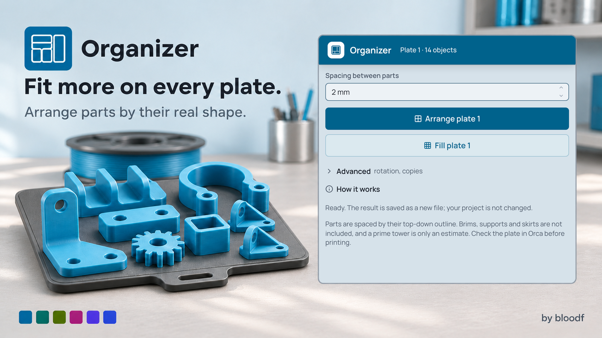
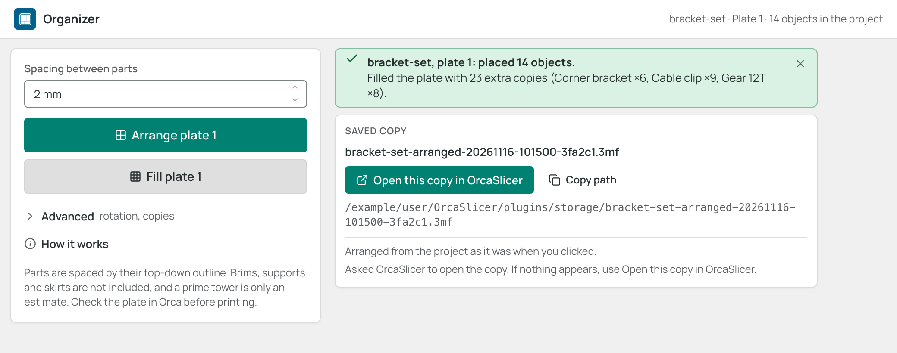
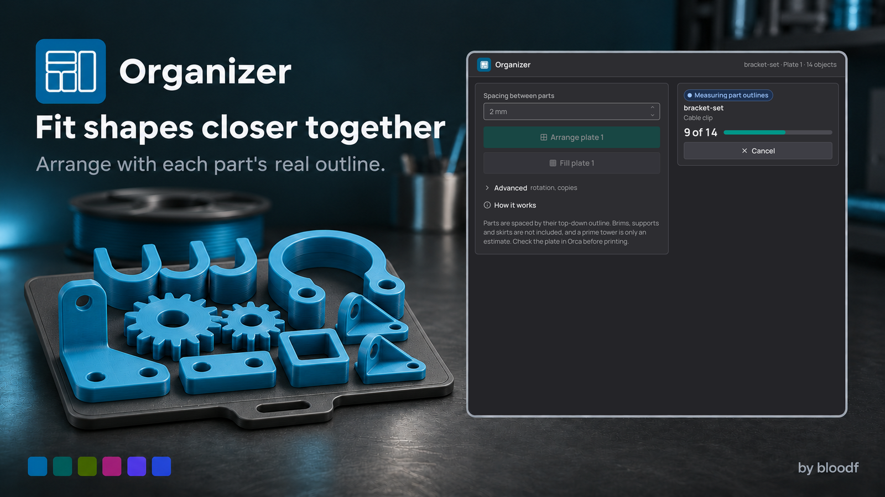
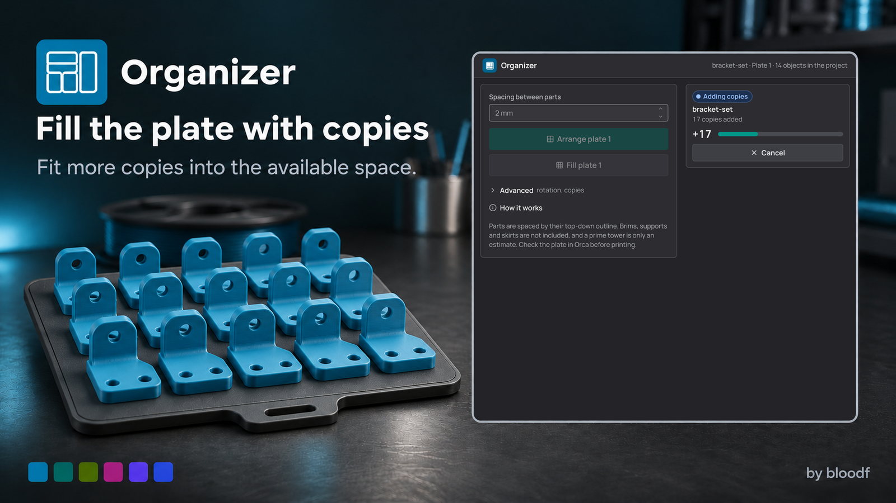
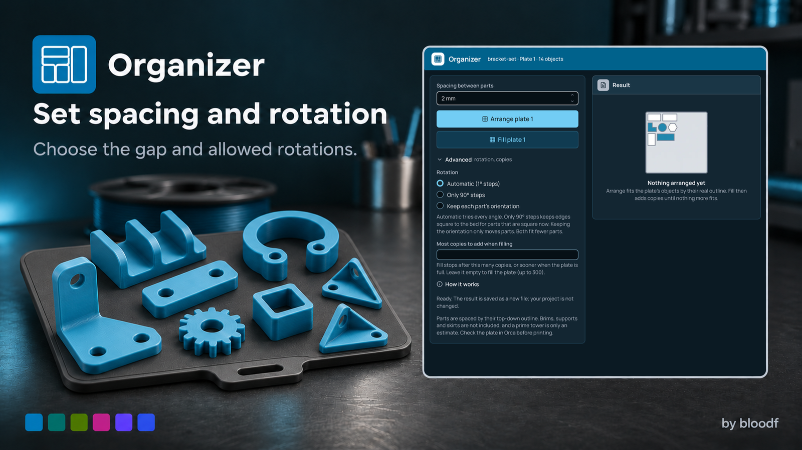
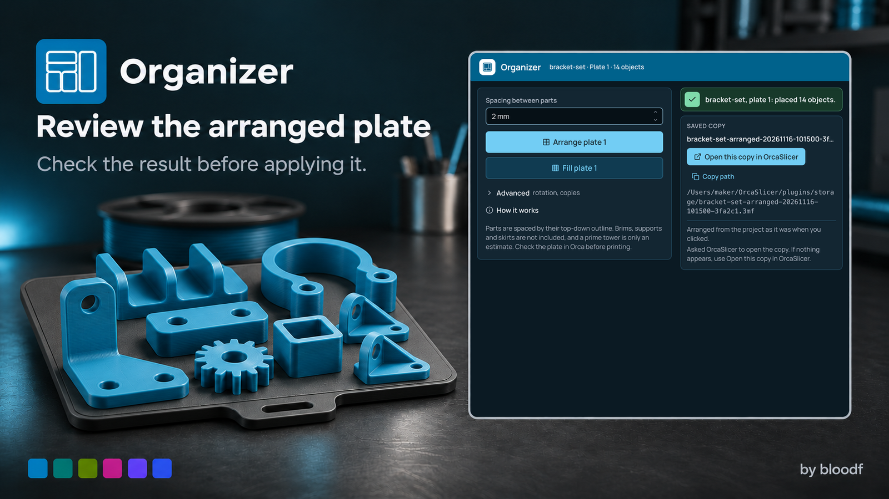
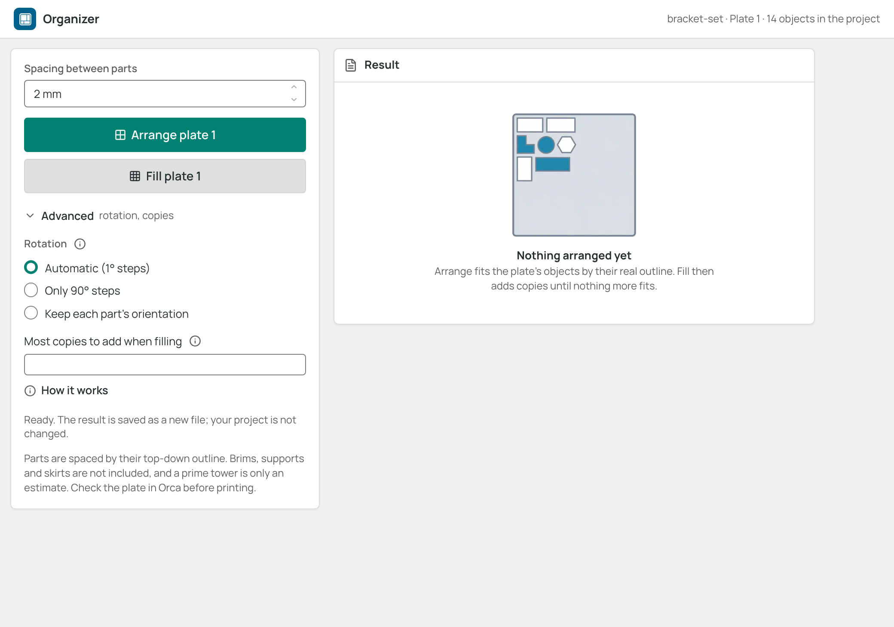

  <picture>
    <source media="(prefers-color-scheme: dark)" srcset="assets/readme/orca_organizer-hero-dark-en.png">
    
  </picture>

<h1 align="center">🧩 Organizer</h1>

<b>Arrange parts by their real outline and fill a plate with more copies.</b> An OrcaSlicer plugin · by bloodf

  
  
  
  

  <a href="#-install">Install</a> · <a href="#-features">Features</a> · <a href="#-how-to-use">How to use</a> · <a href="#-faq">FAQ</a> · <a href="README.pt-BR.md">Português</a>

## ✨ What it does

OrcaSlicer's built-in Arrange treats every object as its convex hull, so concave parts such as snowflakes, stars, combs and letters are spaced as if they were discs or boxes. Organizer arranges a plate by each object's real top-down outline, so arms and teeth interlock and more parts fit. **Fill** then adds copies of the plate's objects until nothing more fits. The result is saved as a new project file and opened in OrcaSlicer; your original file is never modified.

  <picture>
    <source media="(prefers-color-scheme: dark)" srcset="assets/readme/orca_organizer-screen-result-dark-en.png">
    
  </picture>

## 📦 Install

Organizer is on Orca Cloud as *Shape-Aware Arrange*. Sign in to Orca Cloud in OrcaSlicer, open **File > Plugins > Browse plugins**, find it and subscribe, or start from the [plugin page](https://cloud.orcaslicer.com/p/5bf381fd42d4). Updates arrive automatically.

From a file:

1. Download `shape_arrange_any.py` from the [latest release](https://github.com/bloodf/orca_organizer/releases/latest).
2. In OrcaSlicer, open **File > Plugins**.
3. Click the arrow next to **Browse plugins**, choose **Install local plugin** and select the file.
4. Tick **Activate** and allow the thread permission prompt. The arranging runs in the background so OrcaSlicer stays responsive.

| Requirement | Version |
|---|---|
| OrcaSlicer | 2.5 or later (the first with the Python plugin system) |
| System WebView | macOS 14.5 or later (WebKit 17.5), Windows WebView2, Linux WebKitGTK 2.44 or later |
| Python packages | `numpy` and `pillow`, installed by OrcaSlicer on first install |
| Project | 3MF in millimetres |

## 🧰 Features

<table>
  <tr>
    <td width="50%" valign="top">
      
      
<b>Fit shapes closer together</b> Each part is placed by its real top-down outline and tried at all 360 rotations, in 1° steps.

    </td>
    <td width="50%" valign="top">
      
      
<b>Fill the plate with copies</b> Fill adds copies of the plate's objects, one object at a time in turn, until nothing more fits or the number you set is reached.

    </td>
  </tr>
  <tr>
    <td width="50%" valign="top">
      
      
<b>Set spacing and rotation</b> Set the gap in millimetres and choose automatic rotation, only 90° steps, or no rotation at all.

    </td>
    <td width="50%" valign="top">
      
      
<b>Review the arranged plate</b> The result opens as a new project file, with what was placed and what did not fit listed in the panel.

    </td>
  </tr>
</table>

| | Feature | What you get |
|---|---|---|
| | Overhangs | Each footprint is the whole 3D model projected straight down, so nothing is placed under another part's overhang. |
| | Bed edge and excluded areas | The spacing is also kept from the bed edge and from the printer's excluded areas. |
| | Prime tower | On multi-colour plates with the prime tower enabled, its area is kept free, brim included. The depth is an estimate until you slice. |
| | Print by object | Parts stay at least the printer's extruder clearance radius apart, and are arranged as convex hulls, because that is what Orca checks. |
| | Repeating patterns | For copies of the same part, the plugin finds how tightly two copies nest, tiles the bed with that pattern and fits the rest into the gaps. |
| | Finer retry | If parts are left over, the plate is tried once more on a 0.25 mm grid, which lets tight shapes interlock. |
| | Order quantities | *Most copies to add when filling* stops Fill at a set number, 12 for an order of 12. Empty fills the plate, up to 300 copies per run. |
| | Remembered settings | Spacing, rotation and the copy limit of the last run come back after OrcaSlicer restarts. |
| | Progress and Cancel | A run shows its phase and count. **Cancel** stops it at the next checkpoint, and nothing is written or opened. |
| | Nothing else changes | Colours, painting, modifiers, per-object settings and the other plates are kept as they are. |
| | Command line | The nesting core also runs on 3MF files outside OrcaSlicer. See [how it works](docs/how-it-works.md#command-line). |

## 🛠️ How to use

1. Select the plate you want to arrange in OrcaSlicer.
2. Click the **Organizer** tab in the main window. It shows the project, the selected plate and its object count, and follows your selection.
3. Set **Spacing between parts** and click **Arrange plate N**. To add copies as well, click **Fill plate N** instead.
4. Allow the launch prompt the first time. This is how the plugin opens the arranged copy.
5. Read the result. It says how many parts were placed, lists any that did not fit (they are moved into a row above the plate) and shows where the copy was saved, with **Open this copy in OrcaSlicer** and **Copy path**.
6. Slice and check the plate in OrcaSlicer before printing.

  <picture>
    <source media="(prefers-color-scheme: dark)" srcset="assets/readme/orca_organizer-screen-advanced-dark-en.png">
    
  </picture>

Under **Advanced**, *Only 90° steps* turns parts only by quarter turns, so parts that are square to the bed stay square to it. *Keep each part's orientation* turns rotation off and only moves parts. Both fit fewer parts than *Automatic (1° steps)*.

Where OrcaSlicer has no plugin tabs, click **Run** on *Shape-Aware Arrange* in **File > Plugins**. It opens the same controls in a panel docked on the right, and both entries share one run.

The spacing is the gap between the parts' top-down outlines and is never undercut. Positions sit on a 0.5 mm grid, so the real gap is typically about 1 mm larger, up to about 2 mm along slanted edges. The details of every step are in [how it works](docs/how-it-works.md).

## 🔒 Privacy and safety

Organizer works on your computer and makes no network connection. The panel is one offline page embedded in the plugin file, and its tests load it under a content security policy that allows no connections. OrcaSlicer itself downloads `numpy` and `pillow` when the plugin is first installed.

It reads the open project by asking OrcaSlicer to export a copy of it, unsaved changes included. It writes only to the plugin's storage folder: the arranged copies (`<project>-arranged-<date>-<time>-<id>.3mf`), `settings.json` with the last spacing, rotation and copy limit, and a project snapshot in `jobs/<id>/` when a run fails. It keeps the 10 newest snapshots and removes any older than 30 days.

It never modifies your original project file, never overwrites an earlier arranged copy and never deletes one. It asks for two permissions: threads, to work in the background, and launch, to ask OrcaSlicer to open the arranged copy.

The footprint is the model's geometry only. Part brims, supports, skirts and travel moves are not included, and the prime tower is an estimate. The result is an arrangement, not a print check.

## ❓ FAQ

Why does it open a copy instead of moving the parts in my project?

OrcaSlicer 2.5 plugins can read the model but cannot move objects. The plugin exports a copy of the project, rewrites only the object positions in it, saves it as a new file and asks OrcaSlicer to open it.

The gap between parts is larger than the spacing I set.

The spacing is a minimum. Parts are placed on a 0.5 mm grid, so the real gap is typically about 1 mm larger, up to about 2 mm along slanted edges. When the plate prints one object at a time, the printer's extruder clearance radius replaces a smaller spacing, and the result says so.

Some parts did not fit. Where are they?

They are moved into a row above the plate and listed in the result. Lower the spacing, allow automatic rotation, or move some parts to another plate.

Parts overlapped when an object had several instances.

That was a bug in versions before 0.9.5. The plate's parts were read from a list OrcaSlicer saves in the project, which goes stale when instances are added or removed. Since 0.9.5 every part whose position is on the selected plate is taken. Update to the latest version.

OrcaSlicer crashed on start after I installed the plugin.

Versions 0.9.0 to 0.9.2 crashed OrcaSlicer on start. This is fixed in 0.9.3. If you see "Could not start: plugin.storage() must be called from a plugin callback", update as well: that one is fixed in 0.9.4.

I do not see the Organizer tab.

The tab needs an OrcaSlicer with plugin pages, and the number of visible tabs is set under <b>Preferences > General > Plugins > Visible plugin pages</b>. Without the tab, click <b>Run</b> on <i>Shape-Aware Arrange</i> in <b>File > Plugins</b>.

Where are the arranged copies, and can I delete them?

In the plugin's storage folder. The result shows the full path, and <b>Copy path</b> copies it. The plugin does not delete arranged copies, so remove old ones by hand when you no longer need them.

How long does a run take?

A plate whose parts all fit takes a few seconds. A crowded plate that overflows takes about 20 seconds (18 snowflakes of 80 mm), because the finer retry runs too. The work runs in the background, so OrcaSlicer stays usable.

Does it account for brims, supports and the prime tower?

Brims, supports and skirts are not included in the footprint. The prime tower's area is kept free on multi-colour plates, but its depth is only known after slicing, so the plugin reserves an estimate at least as deep as the tower is wide. Check the plate in OrcaSlicer after slicing.

On Windows the arranged copy opened in a second OrcaSlicer window.

That happens unless single-instance mode is on. If no launcher is found, the panel shows the file path so you can open it by hand.

Can parts be mirrored or tilted to fit better?

No. Parts keep their height and stay on the bed. They only move in X and Y and turn around the vertical axis. The full list of limits is in <a href="docs/how-it-works.md#known-limits">how it works</a>.

## 🌍 Languages

English, Brazilian Portuguese, Spanish, German and Simplified Chinese. The panel follows the language OrcaSlicer runs in and shows English for any other.

## 🧩 More plugins by bloodf

| | Plugin | What it does | |
|:-:|---|---|---|
|  | 🧩 **Organizer** · you are here | Arrange parts by their real outline and fill a plate with more copies. | |
|  | 🧲 [Embedder](https://github.com/bloodf/embedder) | Magnet and NFC pockets, with the pause at the right layer. | [Install](https://cloud.orcaslicer.com/p/58222d4f9e52) |
|  | 💰 [Print Calculator](https://github.com/bloodf/orca_print_calculator) | Price every plate: filament, energy, labour, fees and margin. | [Install](https://cloud.orcaslicer.com/p/521c07cf6de2) |
|  | 🧵 [Spooler](https://github.com/bloodf/spooler) | Your Spoolman stock inside OrcaSlicer, with what is left on each spool. | [Install](https://cloud.orcaslicer.com/p/50c35dcbd6f3) |
|  | 🟣 [Kobra Control](https://github.com/bloodf/kobracontrol) | Run the Anycubic Kobra X from OrcaSlicer over your LAN. | [Install](https://cloud.orcaslicer.com/p/59c786285255) |
|  | 🔵 [U1 Control](https://github.com/bloodf/u1control) | Run the Snapmaker U1 from OrcaSlicer: toolheads, camera, files. | [Install](https://cloud.orcaslicer.com/p/55b8c347d443) |

Each plugin works on its own; installed together they share data where it helps.

## 🤝 Contributing

Bug reports and pull requests are welcome. [CONTRIBUTING.md](CONTRIBUTING.md) has the build and test commands, and [docs/](docs/) covers [how the arrangement works](docs/how-it-works.md), [development](docs/development.md) and [releasing](docs/release.md).

## 📄 License

GPL-3.0-or-later. See [LICENSE](LICENSE).

by bloodf

