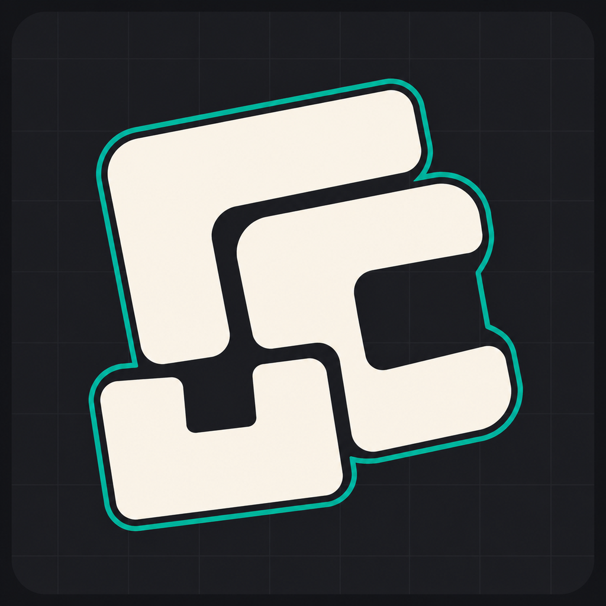
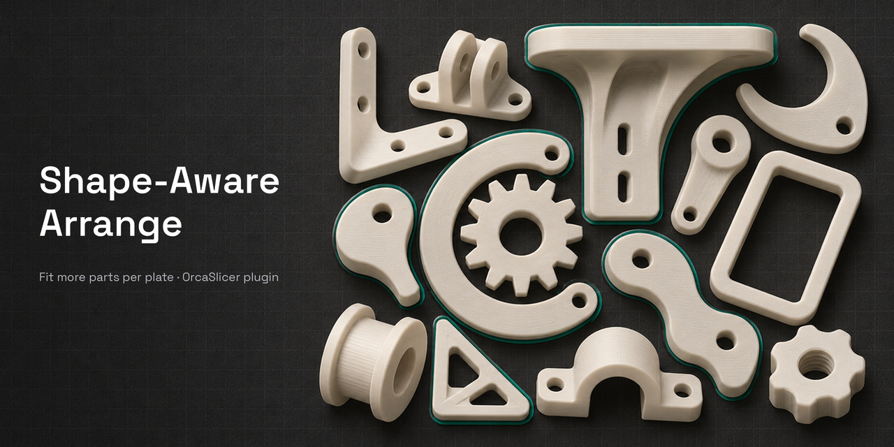
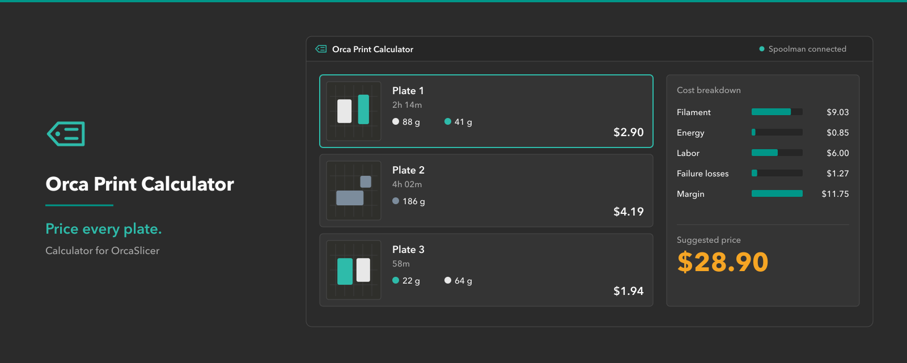
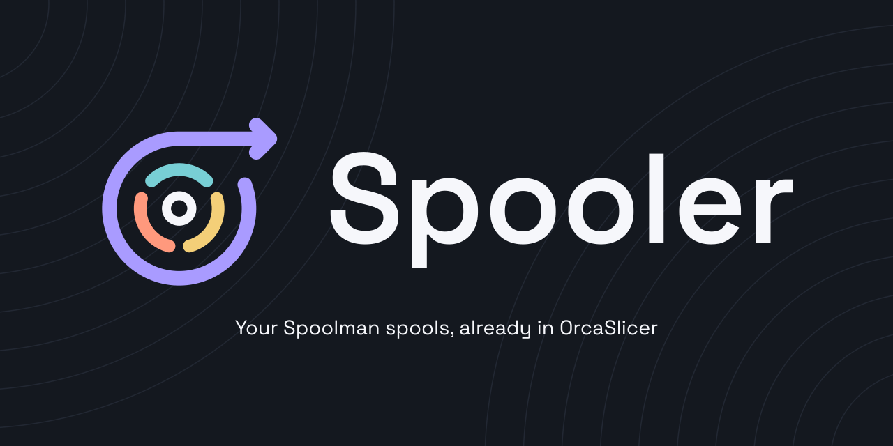
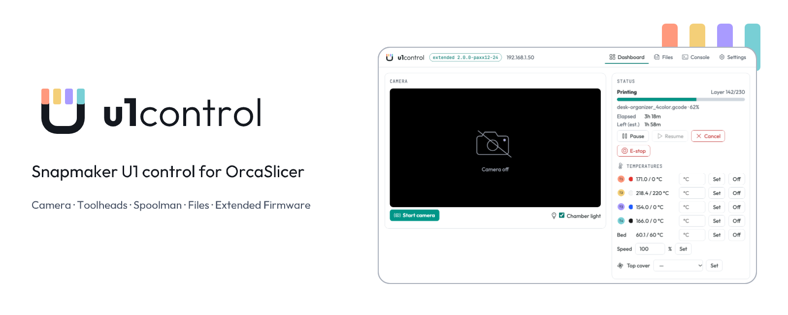

<p align="center"></p>

# Shape-Aware Arrange for OrcaSlicer



OrcaSlicer's built-in Arrange treats every object as its convex hull, so
concave parts like snowflakes, stars, combs and letters end up spaced as if
they were discs or boxes. This plugin arranges a plate using each object's
real top-down footprint, so arms and teeth interlock and more parts fit.

Requires OrcaSlicer 2.5 or later, which has the Python plugin system.

<!-- related-plugins:start -->
## Explore the other plugins

Complete your OrcaSlicer workflow: arrange, price, manage filament and print. Click an image, icon or name to open its repository.

<table>
  <tr>
    <td width="33%" valign="top">
      <a href="https://github.com/bloodf/orca_print_calculator"></a>
      <h3><a href="https://github.com/bloodf/orca_print_calculator">Orca Print Calculator</a></h3>
      <a href="https://github.com/bloodf/orca_print_calculator"></a>
      <p>Calculate plate costs and selling prices, including extras such as keychain rings and magnets.</p>
      <p><a href="https://github.com/bloodf/orca_print_calculator">View repository →</a></p>
    </td>
    <td width="33%" valign="top">
      <a href="https://github.com/bloodf/spooler"></a>
      <h3><a href="https://github.com/bloodf/spooler">Spooler</a></h3>
      <a href="https://github.com/bloodf/spooler"></a>
      <p>Bring your Spoolman spools and filament profiles into OrcaSlicer.</p>
      <p><a href="https://github.com/bloodf/spooler">View repository →</a></p>
    </td>
    <td width="33%" valign="top">
      <a href="https://github.com/bloodf/u1control"></a>
      <h3><a href="https://github.com/bloodf/u1control">U1 Control</a></h3>
      <a href="https://github.com/bloodf/u1control"></a>
      <p>Prepare and monitor Snapmaker U1 prints, with toolhead mapping, temperatures, camera and files.</p>
      <p><a href="https://github.com/bloodf/u1control">View repository →</a></p>
    </td>
  </tr>
</table>

Illustrative project artwork. [Credits and licenses](docs/related-plugins/README.md).
<!-- related-plugins:end -->

## How it works

1. Exports a copy of the current project, unsaved changes included.
2. Rasterizes each object's footprint at every candidate rotation.
3. Places parts largest-first. FFT collision search finds the position that
   keeps the layout's bounding box smallest while staying the set spacing
   away from other parts, the bed edge and any excluded areas.
   If parts are left over, or when filling, it also tries a repeating
   pattern for copies of the same part: it finds how tightly two copies nest,
   also as pairs with one copy turned half a turn (when rotation is on),
   tiles the bed with that pattern and fits the rest into the gaps. The
   result that places more parts wins.
4. Rewrites only the object transforms in the copy, saves it as a new file
   and opens it in OrcaSlicer. Your original project file is never modified,
   and earlier arranged copies are never overwritten.

It works with any model. Collisions are checked on all three axes:

- **X/Y:** each footprint is the whole 3D model projected straight down, so
  an overhang at any height reserves its space. Nothing is placed under
  another part's overhang.
- **Z:** parts keep their height and stay on the bed. They only move in X/Y
  and turn around the vertical axis.
- **Prime tower:** on multi-color plates (two or more filaments, or color
  painting) with the prime tower enabled, the tower's area is kept free,
  brim included, at its position and rotation on that plate. Its depth is
  only known after slicing, so the plugin reserves an estimate: at least as
  deep as it is wide. Check the tower in Orca after slicing.
- **Print by object:** when the plate prints one object at a time, the
  print head drops between finished parts. Parts are then kept at least
  the printer's extruder clearance radius apart in X/Y, even if the spacing
  you set is smaller. Height and print order are still checked by Orca.

The footprint is the model's geometry only: part brims, supports, skirts
and travel moves are not included. The result is an arrangement, not a
print check; slice and review it in Orca before printing.

Orca 2.5 plugins can read the model but cannot move objects, so the plugin
works on a copy and reopens it. Colors, painting, modifiers, per-object
settings and other plates are kept.

## Install

**From Orca Cloud:** sign in to Orca Cloud in OrcaSlicer, open **File > Plugins > Browse plugins**, find *Shape-Aware Arrange* and subscribe ([plugin page](https://cloud.orcaslicer.com/app/plugins/shared-plugins/5bae3da1-7fcc-4cbd-ae25-53678e392d54)). Updates arrive automatically.

**From a file:**

1. In OrcaSlicer, open **File > Plugins**.
2. Click the arrow next to **Browse plugins**, choose **Install local
   plugin**, and select `shape_arrange.py`.
3. Tick **Activate** and allow the thread permission prompt (the arranging
   runs in the background so OrcaSlicer stays responsive). On first install,
   OrcaSlicer installs `numpy` and `pillow` for the plugin.

## Use

1. Select the plate you want to arrange in OrcaSlicer.
2. Click the **Organizer** tab in the main window. It has **Arrange** and
   **Fill** one click away, so you never open the Plugins window or run a
   script. The tab shows the project, the selected plate and its object
   count, and follows your selection. Where the host has no plugin tabs
   (see Known limits), click **Run** on *Shape-Aware Arrange* in
   **File > Plugins** instead: it opens the same controls in a panel docked
   on the right.
3. Set the spacing and click **Arrange plate N**. Everything else is
   automatic: every part tries all 360 rotations (1° steps) and keeps the one
   that packs best. All angles are screened on a coarse grid, and the best 8
   are re-checked at full precision. If parts are left over, the plate is retried once on a finer
   0.25 mm grid, which lets tight shapes interlock.
   **Fill plate N** does the same, then keeps adding copies of
   the plate's objects, one object at a time in turn, until nothing more
   fits. The turns also apply when copies of one object are tiled in a
   repeating pattern. Smaller objects keep filling the gaps once bigger ones
   stop fitting. It adds at most 300 copies per run, and the panel lists how
   many copies of each object were added.
4. Allow the launch prompt the first time; this is how the plugin opens the
   arranged copy. The panel shows how many parts were placed, lists any
   that did not fit (moved into a row above the plate) and always shows
   where the copy was saved, with an **Open this copy in OrcaSlicer** button.

The spacing is the gap kept between parts' top-down outlines. It is never
undercut; because positions sit on a 0.5 mm grid, the real gap is typically
about 1 mm larger, up to about 2 mm along slanted edges. Under
**Advanced**, *Keep each part's orientation* turns rotation off: parts only
move, which fits fewer of them.

Each run is saved as `<project>-arranged-<date>-<time>-<id>.3mf` in the
plugin's storage folder, so earlier results stay. The plugin does not delete
them; remove old ones by hand when you no longer need them.

**Cancel** stops a run at the next checkpoint; nothing is written or
opened. Only one run works at a time, whichever entry you use: the
Organizer tab and the Script's panel share one run, so a second click
shows the running one instead of starting another. If you switch tabs,
close the panel or reload the page during a run, the run continues; come
back to see its progress. A run that finished while nobody was watching is
saved when you return, and **Open this copy in OrcaSlicer** asks Orca to load it. The tab marks a
result that belongs to another project or plate than the one selected now.

A plate whose parts all fit takes a few seconds. A crowded plate that
overflows takes about 20 seconds (18 snowflakes, 80 mm), because the finer
retry runs too. The work runs in the background, so OrcaSlicer stays usable,
and the panel shows progress.

## Command line

## Organizer tab and the Script

The plugin registers two entries that drive one run (they share state):

- **Organizer** is a Pages capability: a tab in the main window, built when
  first shown. Orca's Pages API only offers tabs, so the plugin does not add
  a toolbar button or menu item.
- **Shape-Aware Arrange** is the Script (File > Plugins > Run). It stays for
  hosts and workflows that use it, and opens the same controls docked.

**Language.** The panel is in English and Brazilian Portuguese (pt-BR). It
uses the language OrcaSlicer's UI runs in (`orca.host.app_language()`, from
Orca's Host API) and falls back to the browser's language when the host does
not offer it. Any other language shows English. Part and file names, paths and
the technical details of an unexpected error are shown as they are. A failure
says what went wrong and what to try next, in the panel's language; the raw
error stays as *Details* only when the cause is not one the plugin knows.
"Open this copy in OrcaSlicer" only asks Orca to open the saved file: what Orca
does with its current project or windows was not tested, so the panel does not
say. When the plugin does not answer, the tab says so and offers **Try again**,
which asks the plugin for its state again (the host has no API to reload a tab).

The tab keeps no state: the plugin does. Reloading the tab asks the plugin
for the current run. The plugin never posts to the tab from its worker
thread, because the host does not document that as thread-safe; the tab asks
for progress every second while a run is busy and every three seconds while
idle, and only while it is visible. A host without the Pages capability
loads the plugin without the tab and keeps the Script.

## Command line

The nesting core also runs outside OrcaSlicer on 3MF files in millimetres
(other units are refused):

```sh
uv run --python 3.12 --with numpy --with pillow python shape_arrange.py \
    in.3mf out.3mf --plate 1 --spacing 2 --auto --preview plate.png
```

Add `--fill` to fill the plate with copies.

`--auto` uses the plugin's settings: 1° steps on a 0.5 mm grid, and one
retry on a 0.25 mm grid with 15° steps if parts are left over. Use `--step`
and `--res` instead to choose the rotation step and grid size yourself;
`--step 0` keeps every part's orientation. The CLI writes to the `dst` you
give it, replacing an existing file there.

Pass `--bed 270x270` for plain 3MF files that carry no printer settings.

## Panel source

The Organizer tab and the Script's dock panel are one Vue 3 + PrimeVue 4 app in `ui/` (see
`ui/README.md`). The plugin stays a single `.py` file: `cd ui && npm ci --ignore-scripts && npm run build`
compiles the app into one offline HTML file and embeds it in `shape_arrange.py` (`PANEL_HTML`).
Editing `ui/src` without rebuilding is caught by CI and by `tests/test_panel_js.py`. Python users who
only run or release the plugin need no Node: the built page is committed inside `shape_arrange.py`.

## Test

```sh
uv run --python 3.12 --with numpy --with pillow python tests/test_shape_arrange.py
uv run --python 3.12 --with numpy --with pillow python tests/test_plugin.py
uv run --python 3.12 --with numpy --with pillow python tests/test_panel_js.py
```

`test_panel_js.py` needs Node and `npm ci` in `ui/`. It checks that the page embedded in
`shape_arrange.py` is exactly the one `ui/` builds, that it is offline and needs no
`unsafe-eval`, that its English wording equals the plugin's own, and runs the Vue component
tests (`ui/tests`: validation, focus, every state and message, polling, protocol).

`test_plugin.py` runs the plugin against a stub `orca` module and checks the
threading (the export and the file launch happen on the UI thread, the
nesting does not) and the run lifecycle: closing and reopening the panel,
cancelling, a failed save and earlier results that must stay. It also covers the Organizer
tab (registration, a host without Pages, one run shared with the Script's panel,
stale ids, reload, unload) against a stub Pages host. None of it runs inside OrcaSlicer.

`test_shape_arrange.py` builds a two-plate Orca-style project in which two combs fit on
plate 2 only if their teeth interlock. It arranges the project, then checks
that every part sits on the bed with no overlap and that plate 1 and every
other file in the 3MF are unchanged.

## Known limits

- Parts are not mirrored or tilted; only rotation about Z is tried.
- Only 3MF files in millimetres are accepted. In the model's `<build>`
  section, element prefixes bound to the 3MF core namespace are supported;
  a layout the plugin cannot edit safely is refused with an error.
- The Organizer tab needs a host with the Pages capability, and the tab
  count is set by the host (Preferences > General > Plugins > Visible
  plugin pages). Orca documents no toolbar, menu or shortcut API for
  plugins, so none is used. How a real host delivers `post_message`, when it
  calls `get_ui()` again after a reload and how it lays out the tab were
  not tested in OrcaSlicer; the plugin recovers by asking for state.
- Only English and pt-BR exist, and the pt-BR wording was not reviewed by a
  native speaker beyond the author. The panel's own colors (buttons, errors)
  were chosen for contrast on the light and dark backgrounds it detects; the
  colors Orca really passes were not measured. The panel is a Vue 3 + PrimeVue app
  (`ui/`); it was exercised in headless Chrome with a mock host bridge, never in
  OrcaSlicer's WebView.
- Disabling or reloading the plugin during a run ends the run: its state
  lives in the plugin process. The project snapshot stays in the plugin's
  storage folder and earlier copies are untouched.
- Saving the arranged copy runs on OrcaSlicer's UI thread, so a very large
  project can pause the window briefly while it is written.
- On Windows the arranged copy may open in a second OrcaSlicer window unless
  single-instance mode is on. If no launcher is found, the panel shows the
  file path to open by hand.

## Releasing

1. Bump `version` in the metadata block of `shape_arrange.py` and add a
   section for it to `CHANGELOG.md`. Commit and push.
2. Publish a GitHub release whose tag matches the version:
   `gh release create v0.9.0 --title "Shape-Aware Arrange v0.9.0" --notes ""`
   (or **Draft a new release** in the GitHub UI).
3. The Release workflow tests the tagged code, checks the tag against the
   plugin version, attaches `shape_arrange_any.py` (Orca Cloud requires an
   OS/arch suffix in the file name; `any` means pure Python), fills empty
   release notes from `CHANGELOG.md`, and publishes the version to Orca
   Cloud with those notes as the changelog.

Orca Cloud publishing needs no secrets. The repository is connected to the
plugin under **Edit plugin > GitHub publishing** on Orca Cloud, and the
workflow proves where it runs with a short-lived OIDC token from GitHub.
Orca Cloud only accepts runs triggered by a published release, so pushing
a tag on its own does nothing. If a run fails, fix the cause and re-run it.

## License

GPL-3.0-or-later. See [LICENSE](LICENSE).
