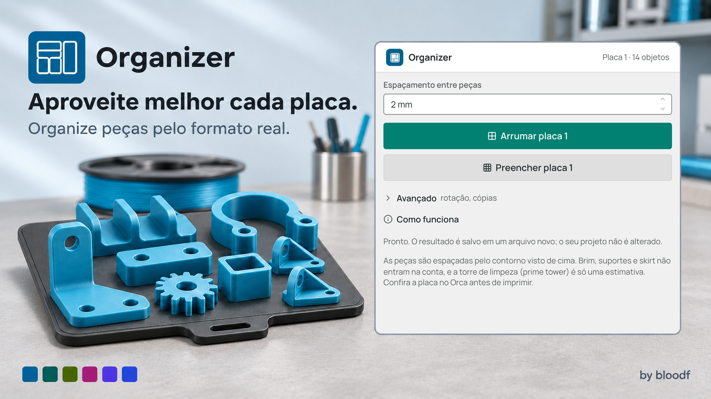
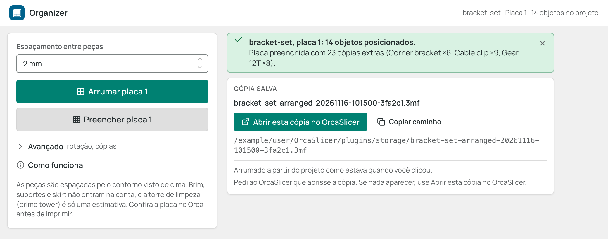
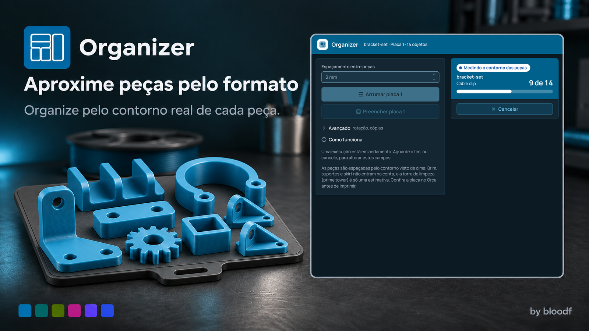
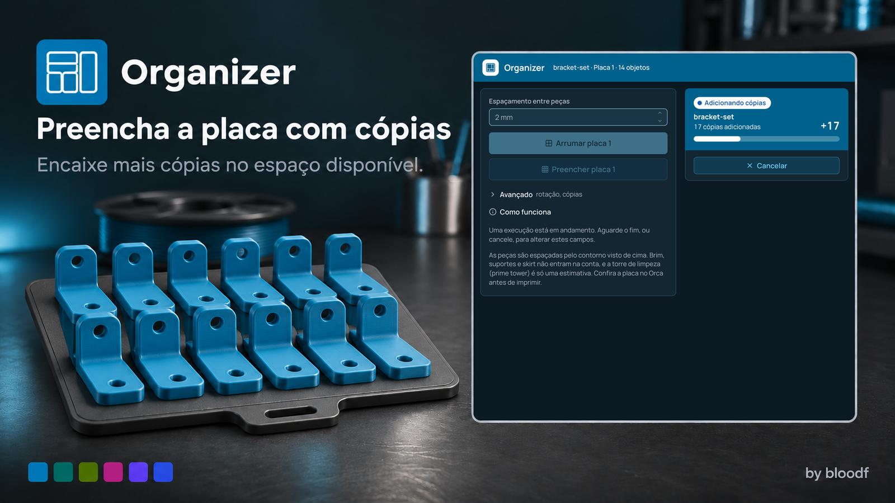
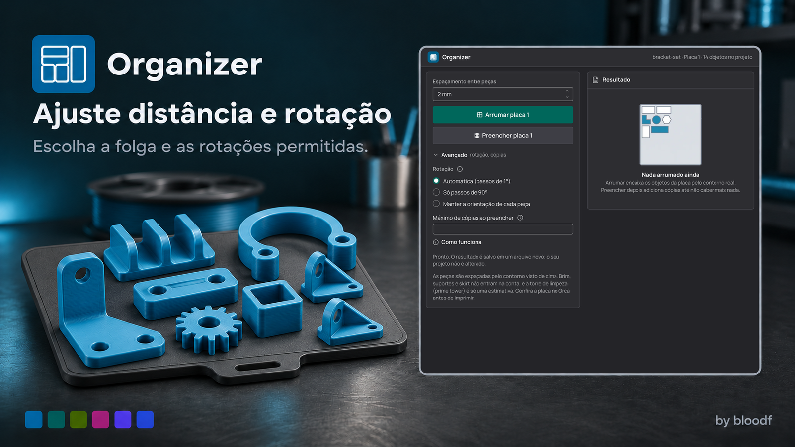
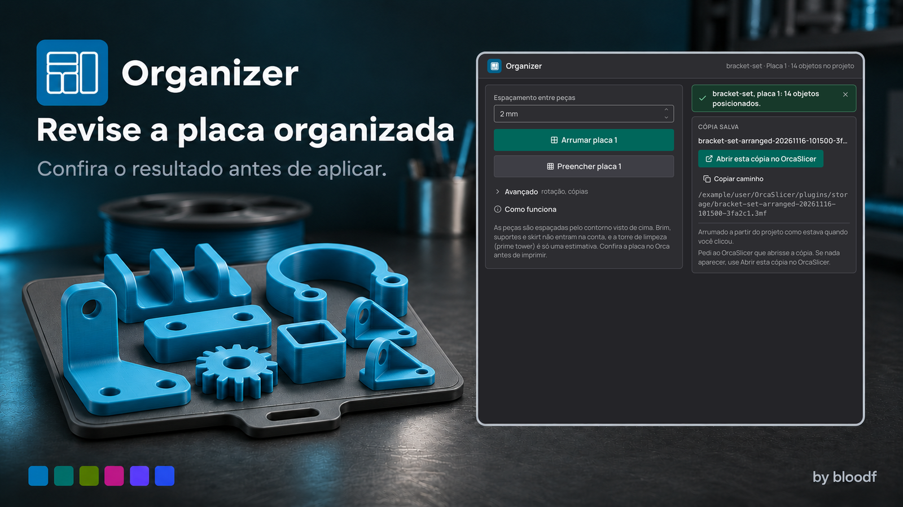
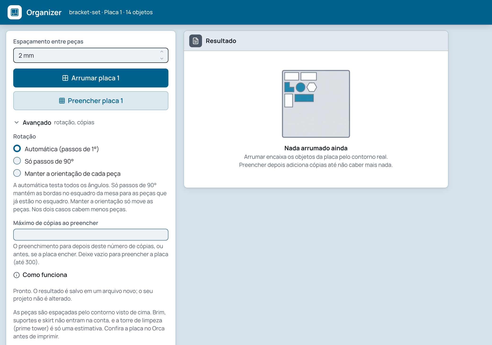

  <picture>
    <source media="(prefers-color-scheme: dark)" srcset="assets/readme/orca_organizer-hero-dark-pt-BR.png">
    
  </picture>

<h1 align="center">🧩 Organizer</h1>

<b>Organize as peças pelo contorno real e encha a mesa com mais cópias.</b> Um plugin para o OrcaSlicer · by bloodf

  
  
  
  

  <a href="#-instalar">Instalar</a> · <a href="#-recursos">Recursos</a> · <a href="#-como-usar">Como usar</a> · <a href="#-perguntas-frequentes">Perguntas frequentes</a> · <a href="README.md">English</a>

## ✨ O que faz

O Organizar do próprio OrcaSlicer trata cada objeto como o seu fecho convexo, então peças côncavas como flocos de neve, estrelas, pentes e letras ficam espaçadas como se fossem discos ou caixas. O Organizer arruma a placa pelo contorno real de cada objeto visto de cima, então braços e dentes se encaixam e cabem mais peças. **Preencher** depois adiciona cópias dos objetos da placa até não caber mais nada. O resultado é salvo em um arquivo de projeto novo e aberto no OrcaSlicer; o seu arquivo original nunca é alterado.

  <picture>
    <source media="(prefers-color-scheme: dark)" srcset="assets/readme/orca_organizer-screen-result-dark-pt-BR.png">
    
  </picture>

## 📦 Instalar

O Organizer está no Orca Cloud com o nome *Shape-Aware Arrange*. Entre no Orca Cloud pelo OrcaSlicer, abra **File > Plugins > Browse plugins**, encontre o plugin e assine, ou comece pela [página do plugin](https://cloud.orcaslicer.com/p/5bf381fd42d4). As atualizações chegam sozinhas.

A partir de um arquivo:

1. Baixe `shape_arrange_any.py` da [última versão](https://github.com/bloodf/orca_organizer/releases/latest).
2. No OrcaSlicer, abra **File > Plugins**.
3. Clique na seta ao lado de **Browse plugins**, escolha **Install local plugin** e selecione o arquivo.
4. Marque **Activate** e aceite o pedido de permissão para threads. A arrumação roda em segundo plano, e o OrcaSlicer continua respondendo.

Os nomes de menu acima são os do OrcaSlicer em inglês.

| Requisito | Versão |
|---|---|
| OrcaSlicer | 2.5 ou mais novo (o primeiro com plugins em Python) |
| WebView do sistema | macOS 14.5 ou mais novo (WebKit 17.5), Windows WebView2, Linux WebKitGTK 2.44 ou mais novo |
| Pacotes Python | `numpy` e `pillow`, instalados pelo OrcaSlicer na primeira instalação |
| Projeto | 3MF em milímetros |

## 🧰 Recursos

<table>
  <tr>
    <td width="50%" valign="top">
      
      
<b>Aproxime peças pelo formato</b> Cada peça é posicionada pelo contorno real visto de cima e testada nas 360 rotações, em passos de 1°.

    </td>
    <td width="50%" valign="top">
      
      
<b>Preencha a placa com cópias</b> Preencher adiciona cópias dos objetos da placa, um objeto por vez, até não caber mais nada ou até o número que você definir.

    </td>
  </tr>
  <tr>
    <td width="50%" valign="top">
      
      
<b>Ajuste distância e rotação</b> Defina a folga em milímetros e escolha rotação automática, só passos de 90° ou nenhuma rotação.

    </td>
    <td width="50%" valign="top">
      
      
<b>Revise a placa organizada</b> O resultado abre como um arquivo de projeto novo, e o painel lista o que foi posicionado e o que não coube.

    </td>
  </tr>
</table>

| | Recurso | O que você ganha |
|---|---|---|
| | Balanços | Cada contorno é o modelo 3D inteiro projetado para baixo, então nada é colocado embaixo do balanço de outra peça. |
| | Borda da mesa e áreas excluídas | O espaçamento também vale para a borda da mesa e para as áreas excluídas da impressora. |
| | Torre de limpeza | Em placas multicoloridas com a torre de limpeza (prime tower) ligada, a área dela fica livre, com o brim. A profundidade é uma estimativa até fatiar. |
| | Impressão por objeto | As peças ficam afastadas pelo menos o raio de folga da extrusora e são arrumadas como fechos convexos, porque é isso que o Orca confere. |
| | Padrões repetidos | Para cópias da mesma peça, o plugin mede o quanto duas cópias se encaixam, cobre a mesa com esse padrão e encaixa o resto nos vãos. |
| | Nova tentativa mais fina | Se sobrarem peças, a placa é tentada mais uma vez em uma grade de 0,25 mm, que deixa formas justas se encaixarem. |
| | Quantidade do pedido | *Máximo de cópias ao preencher* para o Preencher em um número definido, 12 para um pedido de 12. Vazio preenche a placa, até 300 cópias por execução. |
| | Ajustes lembrados | O espaçamento, a rotação e o máximo de cópias da última execução voltam depois de reiniciar o OrcaSlicer. |
| | Progresso e Cancelar | A execução mostra a fase e a contagem. **Cancelar** para no próximo ponto de verificação, e nada é gravado nem aberto. |
| | O resto não muda | Cores, pintura, modificadores, ajustes por objeto e as outras placas ficam como estão. |
| | Linha de comando | O núcleo de encaixe também roda em arquivos 3MF fora do OrcaSlicer. Veja [como funciona](docs/how-it-works.md#command-line) (em inglês). |

## 🛠️ Como usar

1. Selecione no OrcaSlicer a placa que você quer arrumar.
2. Clique na aba **Organizer** da janela principal. Ela mostra o projeto, a placa selecionada e a contagem de objetos, e acompanha a sua seleção.
3. Ajuste o **Espaçamento entre peças** e clique em **Arrumar placa N**. Para também adicionar cópias, clique em **Preencher placa N**.
4. Aceite o pedido de permissão para abrir programas na primeira vez. É assim que o plugin abre a cópia arrumada.
5. Leia o resultado. Ele diz quantas peças foram posicionadas, lista as que não couberam (elas vão para uma fileira acima da placa) e mostra onde a cópia foi salva, com **Abrir esta cópia no OrcaSlicer** e **Copiar caminho**.
6. Fatie e confira a placa no OrcaSlicer antes de imprimir.

  <picture>
    <source media="(prefers-color-scheme: dark)" srcset="assets/readme/orca_organizer-screen-advanced-dark-pt-BR.png">
    
  </picture>

Em **Avançado**, *Só passos de 90°* gira as peças só em quartos de volta, então peças que estão no esquadro da mesa continuam no esquadro. *Manter a orientação de cada peça* desliga a rotação e só move as peças. Nos dois casos cabem menos peças do que com *Automática (passos de 1°)*.

Onde o OrcaSlicer não tem abas de plugin, clique em **Run** no *Shape-Aware Arrange* em **File > Plugins**. Ele abre os mesmos controles em um painel encaixado à direita, e as duas entradas compartilham uma só execução.

O espaçamento é a folga entre os contornos das peças vistos de cima e nunca fica menor do que o pedido. As posições ficam em uma grade de 0,5 mm, então a folga real costuma ser cerca de 1 mm maior, até cerca de 2 mm em bordas inclinadas. Os detalhes de cada etapa estão em [como funciona](docs/how-it-works.md) (em inglês).

## 🔒 Privacidade e segurança

O Organizer trabalha no seu computador e não faz nenhuma conexão de rede. O painel é uma página offline embutida no arquivo do plugin, e os testes a carregam sob uma política de segurança de conteúdo que não permite conexões. O próprio OrcaSlicer baixa `numpy` e `pillow` quando o plugin é instalado pela primeira vez.

Ele lê o projeto aberto pedindo ao OrcaSlicer que exporte uma cópia, com as alterações não salvas. Ele grava só na pasta de armazenamento do plugin: as cópias arrumadas (`<projeto>-arranged-<data>-<hora>-<id>.3mf`), o `settings.json` com o último espaçamento, rotação e máximo de cópias, e uma cópia do projeto em `jobs/<id>/` quando uma execução falha. Ele mantém as 10 cópias de falha mais novas e remove as com mais de 30 dias.

Ele nunca altera o seu arquivo de projeto original, nunca grava por cima de uma cópia arrumada anterior e nunca apaga uma. Ele pede duas permissões: threads, para trabalhar em segundo plano, e abrir programas, para pedir ao OrcaSlicer que abra a cópia arrumada.

O contorno é só a geometria do modelo. Brim, suportes, skirt e movimentos de deslocamento não entram na conta, e a torre de limpeza é uma estimativa. O resultado é uma arrumação, não uma verificação de impressão.

## ❓ Perguntas frequentes

Por que ele abre uma cópia em vez de mover as peças no meu projeto?

Os plugins do OrcaSlicer 2.5 conseguem ler o modelo, mas não mover objetos. O plugin exporta uma cópia do projeto, reescreve só as posições dos objetos nela, salva em um arquivo novo e pede ao OrcaSlicer que o abra.

A folga entre as peças ficou maior do que o espaçamento que eu defini.

O espaçamento é um mínimo. As peças ficam em uma grade de 0,5 mm, então a folga real costuma ser cerca de 1 mm maior, até cerca de 2 mm em bordas inclinadas. Quando a placa imprime um objeto por vez, o raio de folga da extrusora substitui um espaçamento menor, e o resultado avisa.

Algumas peças não couberam. Onde elas estão?

Elas vão para uma fileira acima da placa e aparecem na lista do resultado. Diminua o espaçamento, permita a rotação automática ou passe algumas peças para outra placa.

As peças se sobrepuseram quando um objeto tinha várias instâncias.

Era um defeito das versões anteriores à 0.9.5. As peças da placa eram lidas de uma lista que o OrcaSlicer salva no projeto e que fica desatualizada quando instâncias são adicionadas ou removidas. Desde a 0.9.5 o plugin pega toda peça cuja posição está na placa selecionada. Atualize para a versão mais nova.

O OrcaSlicer travou ao abrir depois que instalei o plugin.

As versões 0.9.0 a 0.9.2 derrubavam o OrcaSlicer ao abrir. Isso foi corrigido na 0.9.3. Se aparecer "Could not start: plugin.storage() must be called from a plugin callback", atualize também: esse foi corrigido na 0.9.4.

Não vejo a aba Organizer.

A aba precisa de um OrcaSlicer com páginas de plugin, e o número de abas visíveis é definido em <b>Preferences > General > Plugins > Visible plugin pages</b>. Sem a aba, clique em <b>Run</b> no <i>Shape-Aware Arrange</i> em <b>File > Plugins</b>.

Onde ficam as cópias arrumadas, e posso apagá-las?

Na pasta de armazenamento do plugin. O resultado mostra o caminho completo, e <b>Copiar caminho</b> o copia. O plugin não apaga as cópias arrumadas, então remova as antigas à mão quando não precisar mais delas.

Quanto tempo leva uma execução?

Uma placa em que todas as peças cabem leva alguns segundos. Uma placa cheia, em que sobram peças, leva cerca de 20 segundos (18 flocos de neve de 80 mm), porque a tentativa mais fina também roda. O trabalho roda em segundo plano, e o OrcaSlicer continua utilizável.

Ele considera brim, suportes e a torre de limpeza?

Brim, suportes e skirt não entram no contorno. A área da torre de limpeza fica livre em placas multicoloridas, mas a profundidade dela só é conhecida depois de fatiar, então o plugin reserva uma estimativa pelo menos tão funda quanto a torre é larga. Confira a placa no OrcaSlicer depois de fatiar.

No Windows a cópia arrumada abriu em uma segunda janela do OrcaSlicer.

Isso acontece quando o modo de instância única está desligado. Se nenhum executável for encontrado, o painel mostra o caminho do arquivo para você abrir à mão.

As peças podem ser espelhadas ou inclinadas para caber melhor?

Não. As peças mantêm a altura e ficam na mesa. Elas só se movem em X e Y e giram em torno do eixo vertical. A lista completa de limites está em <a href="docs/how-it-works.md#known-limits">como funciona</a> (em inglês).

## 🌍 Idiomas

Inglês e português do Brasil. O painel segue o idioma do OrcaSlicer e mostra inglês em qualquer outro.

## 🧩 Mais plugins de bloodf

| | Plugin | O que faz | |
|:-:|---|---|---|
|  | 🧩 **Organizer** · você está aqui | Organize as peças pelo contorno real e encha a mesa com mais cópias. | |
|  | 🧲 [Embedder](https://github.com/bloodf/embedder) | Bolsos para ímãs e NFC, com a pausa na camada certa. | [Instalar](https://cloud.orcaslicer.com/p/58222d4f9e52) |
|  | 💰 [Print Calculator](https://github.com/bloodf/orca_print_calculator) | Preço de cada mesa: filamento, energia, mão de obra, taxas e margem. | [Instalar](https://cloud.orcaslicer.com/p/521c07cf6de2) |
|  | 🧵 [Spooler](https://github.com/bloodf/spooler) | Seu estoque do Spoolman dentro do OrcaSlicer, com o que resta em cada bobina. | [Instalar](https://cloud.orcaslicer.com/p/50c35dcbd6f3) |
|  | 🟣 [Kobra Control](https://github.com/bloodf/kobracontrol) | Controle a Anycubic Kobra X pelo OrcaSlicer na sua rede. | [Instalar](https://cloud.orcaslicer.com/p/59c786285255) |
|  | 🔵 [U1 Control](https://github.com/bloodf/u1control) | Controle a Snapmaker U1 pelo OrcaSlicer: cabeças, câmera, arquivos. | [Instalar](https://cloud.orcaslicer.com/p/55b8c347d443) |

Cada plugin funciona sozinho; instalados juntos, compartilham dados onde ajuda.

## 🤝 Contribuindo

Relatos de defeito e pull requests são bem-vindos. O [CONTRIBUTING.md](CONTRIBUTING.md) tem os comandos de build e teste, e a pasta [docs/](docs/) cobre [como a arrumação funciona](docs/how-it-works.md), o [desenvolvimento](docs/development.md) e a [publicação](docs/release.md). Esses documentos estão em inglês.

## 📄 Licença

GPL-3.0-or-later. Veja [LICENSE](LICENSE).

by bloodf

