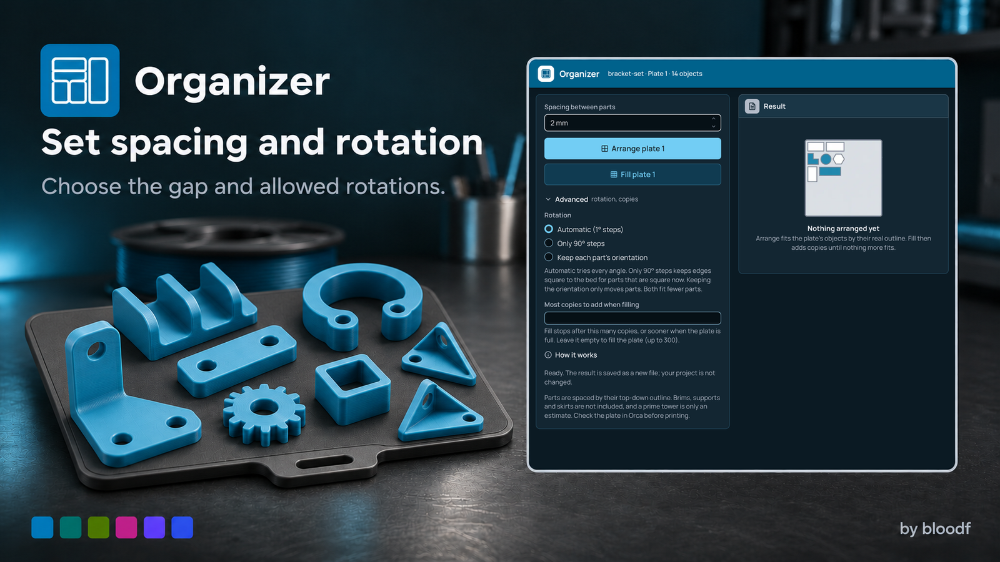

# Orca Cloud description

The text of the Orca Cloud listing ([Organizer](https://cloud.orcaslicer.com/p/5bf381fd42d4)). The listing is English only: paste the block below into the description (2580 characters, the limit is 4000). It links to [README.md](../README.md) for the full description. The images load from `main` on GitHub, so they show once the commit that adds them is merged. The listing slots and image files are in [release.md](release.md).

```markdown
Arrange parts by their real outline and fill a plate with more copies.

Full description: https://github.com/bloodf/orca_organizer/blob/main/README.md


## What it does

- Arranges a plate by each part's real top-down outline instead of its convex hull, so concave parts interlock and more of them fit.
- Tries every rotation in 1° steps, or only 90° steps, or none.
- **Fill** adds copies of the plate's objects until nothing more fits, or stops at the number you set (up to 300 per run).
- Keeps your spacing from other parts, the bed edge, excluded areas and the prime tower.
- Saves the result as a new project file and opens it. Colours, painting, modifiers and other plates are kept.


## Install

Needs OrcaSlicer 2.5 or later. OrcaSlicer installs numpy and Pillow for you.

1. Subscribe on this page.
2. In OrcaSlicer open **Plugins**. macOS: **File > Plugins** in the menu bar. Windows and Linux: the small ▾ arrow right of **File** at the top-left of the window, then **Plugins**.
3. Tick **Activate** on the Organizer row and allow the thread and launch prompts.

## How to use

1. Select a plate and open the **Organizer** tab.
2. Set **Spacing between parts**, then click **Arrange plate N**, or **Fill plate N** to add copies.
3. Check the arranged copy that opens, then slice it.



Brims, supports and skirts are not part of the footprint, and the prime tower is an estimate. Check the plate before printing.


## Privacy

Runs on your computer with no network connection. Your original project is never modified; results go to the plugin's own folder.

Languages: English, Brazilian Portuguese, Spanish, German, Simplified Chinese and Polish.

More plugins by bloodf: [Embedder](https://cloud.orcaslicer.com/p/58222d4f9e52) · [Print Calculator](https://cloud.orcaslicer.com/p/521c07cf6de2) · [Spooler](https://cloud.orcaslicer.com/p/50c35dcbd6f3) · [Kobra Control](https://cloud.orcaslicer.com/p/59c786285255) · [U1 Control](https://cloud.orcaslicer.com/p/55b8c347d443)
```
