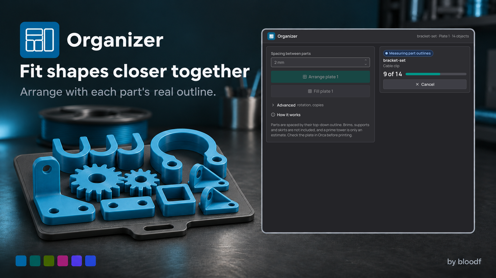
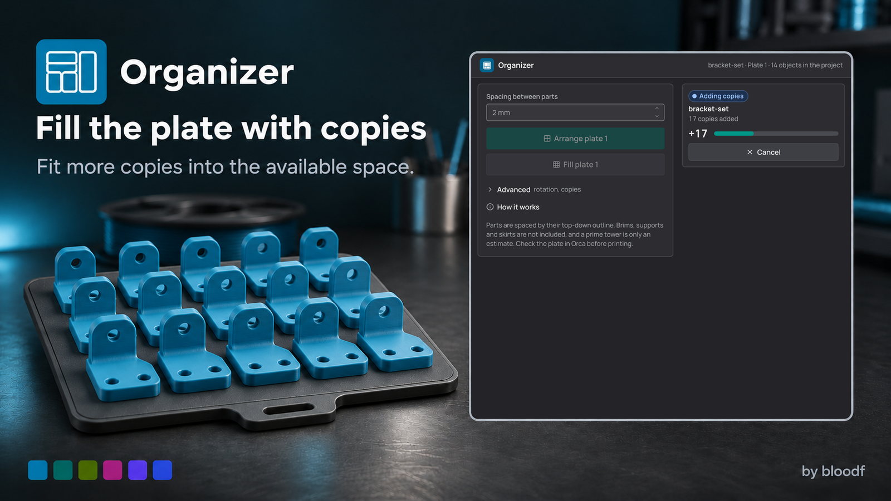
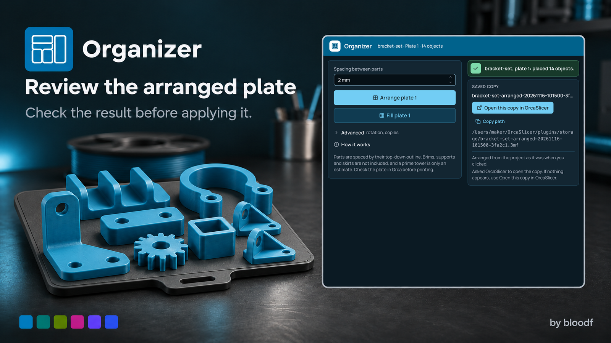

# Orca Cloud description

The text of the Orca Cloud listing ([Shape-Aware Arrange](https://cloud.orcaslicer.com/p/5bf381fd42d4)). Paste the
English block into the English description and the Portuguese block into the Portuguese one. Each block is
under 4000 characters (3354 and 3499). The images load from `main` on GitHub, so they show once the commit
that adds them is merged. The listing slots and image files are in [release.md](release.md).

Short description (one line): `Arrange parts by their real outline and fill a plate with more copies.` /
`Organize as peças pelo contorno real e encha a mesa com mais cópias.`

## English

```markdown
Arrange parts by their real outline and fill a plate with more copies.



## What you need

- OrcaSlicer 2.5 or later
- A project in millimetres with at least one object on the plate
- Nothing else: `numpy` and `pillow` are installed by OrcaSlicer when the plugin is first installed

## What it does

- Arranges a plate by each object's real top-down outline, not its convex hull, so concave parts interlock and more of them fit.
- Tries every part at all 360 rotations in 1° steps. You can limit it to 90° steps or turn rotation off.
- **Fill** adds copies of the plate's objects, one object at a time in turn, until nothing more fits or the number you set is reached (up to 300 per run).
- Keeps the spacing you set from other parts, the bed edge, excluded areas and, on multi-color plates, the prime tower.
- Saves the result as a new project file and opens it. Colors, painting, modifiers, per-object settings and other plates are kept.



## How to start

1. Select a plate and click the **Organizer** tab in the main window.
2. Set **Spacing between parts** and click **Arrange plate N**, or **Fill plate N** to add copies too.
3. Allow the launch prompt the first time, then check the arranged copy that opens and slice it.


Where OrcaSlicer has no plugin tabs, click **Run** on *Shape-Aware Arrange* in **File > Plugins** for the same controls in a docked panel.

## Privacy

Everything runs on your computer and the plugin makes no network connection. It writes only to its own storage folder: the arranged copies, the last settings you used and a snapshot of a run that failed. Your original project file is never modified, and earlier arranged copies are never overwritten or deleted.

The footprint is the model's geometry only: brims, supports and skirts are not included, and the prime tower is an estimate. Check the plate in OrcaSlicer before printing.



## Languages

English and Brazilian Portuguese, following OrcaSlicer's language.

## More plugins by bloodf

- [Embedder](https://cloud.orcaslicer.com/p/58222d4f9e52): Magnet and NFC pockets, with the pause at the right layer.
- [Print Calculator](https://cloud.orcaslicer.com/p/521c07cf6de2): Price every plate: filament, energy, labour, fees and margin.
- [Spooler](https://cloud.orcaslicer.com/p/50c35dcbd6f3): Your Spoolman stock inside OrcaSlicer, with what is left on each spool.
- [Kobra Control](https://cloud.orcaslicer.com/p/59c786285255): Run the Anycubic Kobra X from OrcaSlicer over your LAN.
- [U1 Control](https://cloud.orcaslicer.com/p/55b8c347d443): Run the Snapmaker U1 from OrcaSlicer: toolheads, camera, files.

Each plugin works on its own; installed together they share data where it helps.

## Source code

GPL-3.0-or-later: https://github.com/bloodf/orca_organizer
```

## Português (Brasil)

```markdown
Organize as peças pelo contorno real e encha a mesa com mais cópias.


## O que você precisa

- OrcaSlicer 2.5 ou mais novo
- Um projeto em milímetros com pelo menos um objeto na mesa
- Mais nada: `numpy` e `pillow` são instalados pelo OrcaSlicer na primeira instalação do plugin

## O que faz

- Arruma a mesa pelo contorno real de cada objeto visto de cima, não pelo fecho convexo, então peças côncavas se encaixam e cabem mais.
- Testa cada peça nas 360 rotações, em passos de 1°. Dá para limitar a passos de 90° ou desligar a rotação.
- **Preencher** adiciona cópias dos objetos da mesa, um objeto por vez, até não caber mais nada ou até o número que você definir (até 300 por execução).
- Mantém o espaçamento definido em relação às outras peças, à borda da mesa, às áreas excluídas e, em mesas multicoloridas, à torre de limpeza.
- Salva o resultado em um arquivo de projeto novo e o abre. Cores, pintura, modificadores, ajustes por objeto e as outras mesas são mantidos.


## Como começar

1. Selecione uma mesa e clique na aba **Organizer** da janela principal.
2. Ajuste o **Espaçamento entre peças** e clique em **Arrumar placa N**, ou em **Preencher placa N** para também adicionar cópias.
3. Aceite o pedido de permissão na primeira vez, confira a cópia arrumada que abre e fatie.


Onde o OrcaSlicer não tem abas de plugin, clique em **Run** no *Shape-Aware Arrange* em **File > Plugins** para ter os mesmos controles em um painel encaixado.

## Privacidade

Tudo roda no seu computador, e o plugin não faz nenhuma conexão de rede. Ele grava só na própria pasta de armazenamento: as cópias arrumadas, os últimos ajustes usados e uma cópia do projeto de uma execução que falhou. O seu arquivo de projeto original nunca é alterado, e as cópias arrumadas anteriores nunca são sobrescritas nem apagadas.

O contorno é só a geometria do modelo: brim, suportes e skirt não entram na conta, e a torre de limpeza é uma estimativa. Confira a mesa no OrcaSlicer antes de imprimir.


## Idiomas

Inglês e português do Brasil, seguindo o idioma do OrcaSlicer.

## Mais plugins de bloodf

- [Embedder](https://cloud.orcaslicer.com/p/58222d4f9e52): Bolsos para ímãs e NFC, com a pausa na camada certa.
- [Print Calculator](https://cloud.orcaslicer.com/p/521c07cf6de2): Preço de cada mesa: filamento, energia, mão de obra, taxas e margem.
- [Spooler](https://cloud.orcaslicer.com/p/50c35dcbd6f3): Seu estoque do Spoolman dentro do OrcaSlicer, com o que resta em cada bobina.
- [Kobra Control](https://cloud.orcaslicer.com/p/59c786285255): Controle a Anycubic Kobra X pelo OrcaSlicer na sua rede.
- [U1 Control](https://cloud.orcaslicer.com/p/55b8c347d443): Controle a Snapmaker U1 pelo OrcaSlicer: cabeças, câmera, arquivos.

Cada plugin funciona sozinho; instalados juntos, compartilham dados onde ajuda.

## Código-fonte

GPL-3.0-or-later: https://github.com/bloodf/orca_organizer
```
